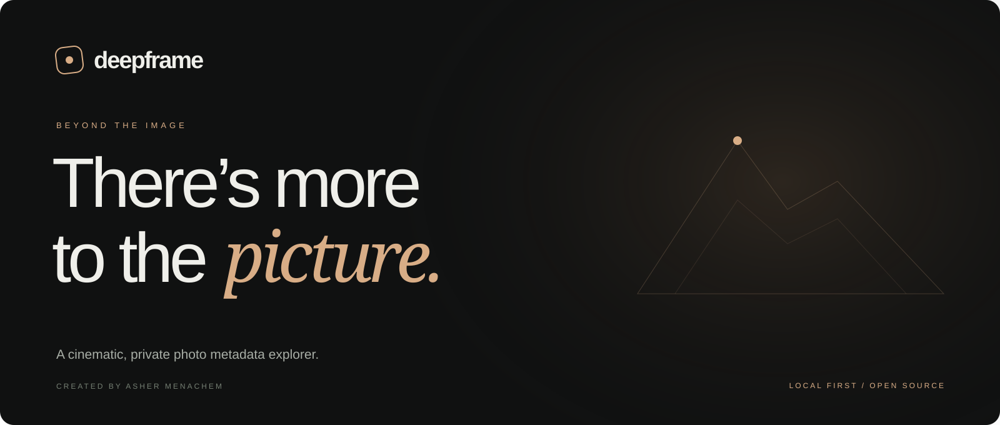
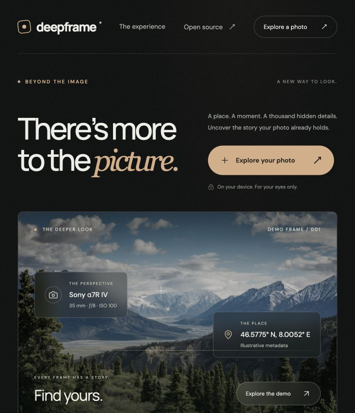

<p align="center"></p>
<p align="center">
<a href="https://ashermenachem.github.io/deepframe/">Explore Deepframe ↗</a> &nbsp;·&nbsp; <a href="#start-in-one-command">Run locally</a> &nbsp;·&nbsp; <a href="#made-by-asher-menachem">Meet the creator</a>
</p>
<p align="center">


</p>

## A different perspective

A photograph is more than pixels. It can hold a place, an exact moment, the camera that captured it, and the settings behind the shot. **Deepframe turns those hidden details into a clear, cinematic experience.**

Warm light. Quiet typography. Slow camera movement. Floating annotations. An interface that lets the photograph lead.



## The story, beautifully organized

| First things first        | What you can discover                                              |
| :------------------------ | :----------------------------------------------------------------- |
| **Coordinates**           | Latitude, longitude, altitude, and an optional Maps link           |
| **Date and time**         | Original camera time and a recorded UTC offset, when available     |
| **Phone / camera**        | Manufacturer, model, and lens                                      |
| **Settings**              | Aperture, shutter speed, ISO, and focal length                     |
| **Every readable detail** | EXIF, GPS, XMP, IPTC, ICC color profiles, and image structure      |
| **The file itself**       | Name, dimensions, resolution, size, modification time, and SHA-256 |

- Choose an image or drag it into the browser.
- Read the key facts first, then explore collapsible metadata sections.
- Search every field and export a structured JSON report, including raw binary metadata arrays. Binary fields can also be expanded in the report.
- Try the clearly labeled illustrative demo before choosing a photo.
- Enjoy responsive layouts, keyboard support, and reduced-motion preferences.

## Start in one command

First install **[Node.js LTS](https://nodejs.org/)** (includes npm) and **[Git](https://git-scm.com/downloads)**. Open Terminal on Mac, or PowerShell on Windows, then paste this entire line:

```sh
git clone https://github.com/ashermenachem/deepframe.git && cd deepframe && npm ci && npm run dev
```

Open the **Local** address printed in the terminal, usually **http://localhost:5173**. You’re ready. Keep the terminal open while using the site; press **Ctrl+C** to stop it. The command works on macOS, Linux, and PowerShell 7+. On older Windows PowerShell, run the four steps below separately.

<details>
<summary>Prefer one step at a time? Click here.</summary>

```sh
git clone https://github.com/ashermenachem/deepframe.git
```

Downloads Deepframe into a new folder.

```sh
cd deepframe
```

Moves your terminal into that folder.

```sh
npm ci
```

Installs the exact dependencies used by the project.

```sh
npm run dev
```

Starts the local website. Next time, you only need `cd deepframe` and `npm run dev`.

If the folder already exists, use a different folder name or open your existing copy. If the port is busy, Vite prints another available Local address.

</details>

## Private by design

**Selected photos are read locally.** There is no upload endpoint, photo storage, analytics, or account system in the app. The host serves the website; Google Fonts supplies typography. Opening a Maps link sends the displayed coordinates to Google Maps, only when you choose to click it. Exported reports may include location or device details, so share them intentionally.

## What a photo can—and cannot—tell you

Deepframe displays metadata that actually exists and that its parser can read. It does not guess missing locations, identify people, recover stripped data, or authenticate an image. Metadata is editable and is not evidence of authenticity.

JPEG, TIFF, HEIC/HEIF, PNG, and AVIF metadata are supported through [exifr](https://github.com/MikeKovarik/exifr); coverage varies by format and metadata block. Other browser-readable images still show basic file information. Some proprietary camera maker notes remain raw binary. Not every format or vendor-specific field can be decoded. HEIC and TIFF previews depend on browser support; metadata can remain readable when previews are unavailable. Files are limited to 60 MB to protect browser responsiveness.

Capture times without a recorded offset are shown as camera time, with no invented time zone. File modification time is separate and may reflect downloading or copying. Demo coordinates, camera details, and dates are illustrative values, not extracted from the landscape image.

## For builders

```sh
npm test          # Metadata parsing, GPS boundaries, exposure formatting, HTML safety
npm run build     # Create a production website in dist/
npm run preview   # Preview the production build locally
```

**Stack:** Vanilla JavaScript · Vite · exifr · Lucide icons · CSS animation. No backend, database, or API keys required.

```text
src/main.js       Photo flow, rendering, export, animation
src/metadata.js   Metadata formatting and coordinate normalization
src/style.css    Responsive visual system and motion
public/assets/   Local landscape image
test/           Metadata regression tests
```

GitHub Actions checks the project and publishes the production build to GitHub Pages. The `.openai/hosting.json` file configures the separate private Sites deployment. Forks can remove that file and deploy `dist/` to any static host. To use GitHub Pages on a fork, choose **GitHub Actions** under **Settings → Pages**, then run the included workflow.

## Made by Asher Menachem

Designed and built for people who look a little closer.

[GitHub](https://github.com/ashermenachem) &nbsp; / &nbsp; [Instagram](https://www.instagram.com/ashermenachem/?hl=en) &nbsp; / &nbsp; [X](https://x.com/ashermenachem) &nbsp; / &nbsp; [TikTok](https://www.tiktok.com/@ashermenachem) &nbsp; / &nbsp; [Snapchat](https://www.snapchat.com/@asher.menachem)

Code is released under the [MIT license](LICENSE). Landscape image from [Unsplash](https://images.unsplash.com/photo-1464822759023-fed622ff2c3b); image rights remain with the original photographer under the [Unsplash license](https://unsplash.com/license). Icons by [Lucide](https://lucide.dev/) (ISC). Fonts: DM Sans and Manrope, available under the SIL Open Font License through Google Fonts.

<p align="center"><br><sub>DEEPFRAME — A LITTLE CURIOSITY CHANGES EVERYTHING.</sub></p>
